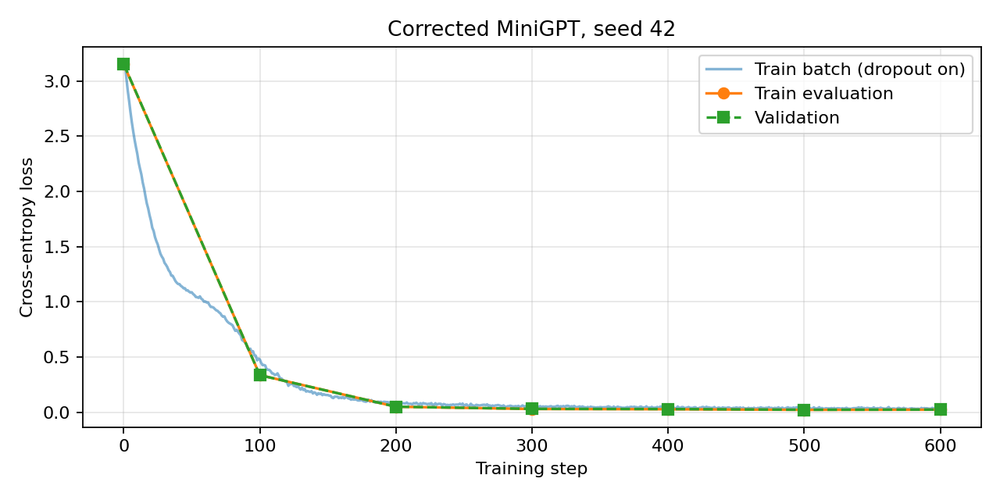

# Отчёт: внимание и исправление ошибок

Персональный вариант исходного `dz1-bughunt.ipynb`: **seed 42, три семантические ошибки**.

## Реализация внимания

`split_heads` разбивает признаки токена между головами и преобразует `(B, L, D)` в `(B, H, L, D/H)`. `merge_heads` выполняет обратную перестановку и объединяет признаки голов.

Внимание вычисляет `softmax(QKᵀ / sqrt(d_k), dim=-1) @ V`. Маска заменяет запрещённые логиты на `-inf` до softmax, dropout применяется к весам после него. Функция возвращает результат и веса внимания.

Блок использует pre-norm: `x = x + attn(norm1(x))`, затем `x = x + ffn(norm2(x))`. Остаточные связи сохраняются для обоих подслоёв.

Самым неочевидным оказался порядок маскирования. Значение `-inf` до softmax исключает будущие позиции и сохраняет сумму весов, равную единице. Обнуление весов после softmax нарушило бы эту сумму.

## Найденные ошибки

Номера строк относятся к коду исходной ячейки «Код с подсаженными ошибками», четвёртой ячейки второго ноутбука, и считаются с единицы внутри неё.

| № | Локализация | Механизм нарушения и причина сбоя | Исправление |
|---|---|---|---|
| 1 | `sinusoidal_positional_encoding`, строка 39: `arange(1, length + 1)` | Позиция p получает код p+1. На нулевой позиции синусы не равны 0, косинусы — 1, что нарушает заданную формулу. Сам сдвиг не исключает обучение. | `torch.arange(length, dtype=torch.float32)`. |
| 2 | `LayerNorm.forward`, строки 60–61: `mean(dim=0)`, `var(dim=0)` | Статистики считаются между примерами батча вместо признаков токена. Выход зависит от соседних примеров. При B=1 центрированный вход равен нулю, выход сводится к bias и теряет зависимость от контекста. | В обеих операциях `dim=-1`, сохранив `keepdim=True` и `unbiased=False`. |
| 3 | `scaled_dot_product_attention`, строка 101: `softmax(scores, dim=-2)` | Нормирование по запросам не даёт распределения по ключам для каждого токена. Будущие запросы влияют на знаменатель весов ранних запросов даже при причинной маске. | `torch.softmax(scores, dim=-1)`. |

## Проверка и обучение

В обоих ноутбуках прошли **17 из 17** проверок. Код проверок не менялся, выводы ячеек сохранены в `.ipynb`.

Seed эксперимента — 42. Обучение длится 600 шагов на корпусе из повторяющейся фразы. Последние 10% данных выделены для валидации; оценка выполняется без dropout через каждые 100 шагов. Такая валидация показывает усвоение шаблона, но не обобщение на новые тексты.

В модели **400 640 параметров**, словарь содержит **19 символов**, корпус — **9 600 символов**. Прогон выполнен в **Google Colab на Tesla T4** и занял **8,4 с**. Среда: Python 3.13.16, PyTorch 2.11.0+cu130, CUDA 13.0, matplotlib 3.10.0.

| Выполнено обновлений | Train loss, eval | Validation loss |
|---|---:|---:|
| 0 | 3,1527 | 3,1556 |
| 100 | 0,3363 | 0,3356 |
| 200 | 0,0497 | 0,0499 |
| 300 | 0,0289 | 0,0302 |
| 400 | 0,0268 | 0,0286 |
| 500 | 0,0213 | 0,0220 |
| 600 | 0,0227 | 0,0235 |

Потери обучающего батча с dropout уменьшились с **3,1525 до 0,0288**.



Генерация при seed 42, стартовом символе `а`, `temperature=0.8`, `top_k=10` и 200 новых символах:

```text
азу. алгоритм внимания смотрит на все позиции сразу. алгоритм внимания смотрит на все позиции сразу. алгоритм внимания смотрит на все позиции сразу. алгоритм внимания смотрит на все позиции сразу. алго
```

Модель воспроизводит слова, пробелы и пунктуацию обучающей фразы.

### Сравнение CPU и T4

Для интереса сравнил два прогона с одинаковыми настройками модели, корпусом, seed 42 и 600 шагами обучения.

| Показатель | CPU | Tesla T4 |
|---|---:|---:|
| Время обучения с оценкой, с | 44,9 | 8,4 |
| Последняя batch loss (с dropout) | 0,0303 | 0,0288 |
| Итоговая train loss (без dropout) | 0,0266 | 0,0227 |
| Итоговая validation loss | 0,0267 | 0,0235 |
| Проверки в каждом ноутбуке | 17/17 | 17/17 |

На T4 обучение прошло примерно в 5,4 раза быстрее. Потери получились немного ниже, а генерация в обоих случаях воспроизводит обучающую фразу. По одному прогону нельзя связать улучшение качества именно с GPU: на CPU и CUDA различаются случайные вычисления, включая dropout, а версии PyTorch тоже разные — 2.9.0+cpu и 2.11.0+cu130. Основной результат сравнения — ускорение выполнения.

Численные результаты: [metrics.json](artifacts/metrics.json). Полная история: [loss_history.csv](artifacts/loss_history.csv). Конфигурация среды: [environment.json](artifacts/environment.json). Пример генерации: [generated.txt](artifacts/generated.txt).

Инструкция воспроизведения с нуля, включая бесплатный Colab и CPU-окружение, находится в [README.md](README.md).
